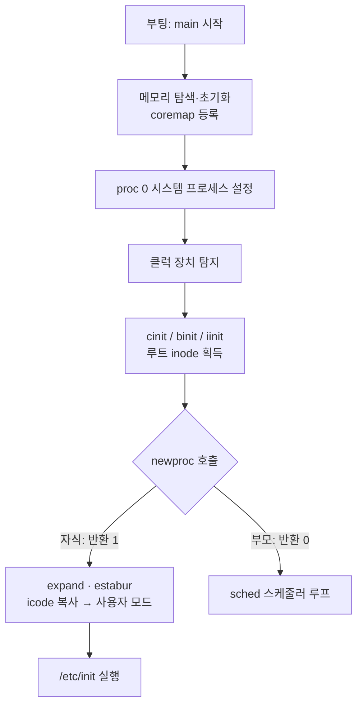

# UNIX V6 커널 분석: main()에서 newproc()까지

> System Programming 과제 (개인) · UNIX V6 Lions Code 분석
> 분석 대상: `main.c`의 `main()` (1550–1638행) + `slp.c`의 `newproc()` (1826–1919행), 총 약 180줄

---

## 1. 분석 목적과 대상 선정 이유

UNIX V6 커널이 켜진 직후 **"메모리를 찾고, 자료구조를 만들고, 첫 번째 사용자 프로세스(init)를 탄생시키는 과정"** 을 코드 수준에서 이해하는 것이 목적이다.

- `main()`은 부팅 후 가장 먼저 실행되는 함수라서 커널 초기화 순서를 한눈에 볼 수 있다.
- `newproc()`은 시스템 콜 `fork()`(3323행)가 호출하는, 실제 프로세스 복제를 수행하는 함수다. `main()`은 시스템 콜을 거치지 않고 `newproc()`을 직접 호출해 init을 만든다.
- 두 함수를 이어서 보면 **부팅 → 프로세스 생성**이라는 하나의 흐름이 된다.

> 소스: [Lions' Commentary on UNIX 6th Edition](https://warsus.github.io/lions-/)
> 참고: V6 코드는 `=|`, `=+` 같은 옛 문법을 쓴다. `=|`는 `|=`, `=+`는 `+=`와 같은 뜻이다.

---

## 2. 전체 흐름



---

## 3. Part 1: `main()` 분석 (main.c 1550~1638행)

### 3-1. 메모리 탐색과 초기화 (1559~1570행)

부팅 직후에는 메모리가 얼마나 있는지 알 수 없다. 그래서 64바이트 블록 단위로 **직접 읽어보면서** 끝을 찾는다.

```c
1559:         updlock = 0;
1560:         i = *ka6 + USIZE;
1561:         UISD->r[0] = 077406;
1562:         for(;;) {
1563:                 UISA->r[0] = i;
1564:                 if(fuibyte(0) < 0)
1565:                         break;
1566:                 clearseg(i);
1567:                 maxmem++;
1568:                 mfree(coremap, 1, i);
1569:                 i++;
1570:         }
```

| 줄 | 설명 |
|---|---|
| 1560 | `i`에 커널 영역 바로 뒤의 첫 검사 블록 번호를 넣는다. |
| 1562 | `for(;;)` 무한 반복. 1564행의 `break`로만 빠져나온다. |
| 1564 | `fuibyte(0) < 0`이면 읽기에 실패한 것으로, 실제 메모리의 끝에 도달했다는 뜻이다. |
| 1566 | `clearseg(i)`로 해당 블록을 0으로 지운다. |
| 1567 | `maxmem++`로 사용 가능한 블록 수를 센다. |
| 1568 | `mfree(coremap, 1, i)`로 빈 공간 관리표(coremap)에 등록한다. |

**핵심 개념**: 새 건물에 들어가 방을 하나씩 열어보고, 청소한 뒤 빈방 목록에 적는 것과 같다.

### 3-2. 메모리 크기 출력, 제한, 스왑 등록 (1576~1583행)

```c
1576:         printf("mem = %l\n", maxmem*5/16);
1577: 
1578: 
1579: 
1580: 
1581: 
1582:         maxmem = min(maxmem, MAXMEM);
1583:         mfree(swapmap, nswap, swplo);
```

- 1576행: `printf`로 전체 메모리 크기를 콘솔에 출력한다.
- 1582행: `maxmem = min(maxmem, MAXMEM)`으로 사용자 프로그램이 쓸 수 있는 최대 메모리를 정한다. 실제 메모리, 설치 시 정한 `MAXMEM`, PDP-11 구조의 상한 중 가장 작은 값이다.
- 1583행: `mfree(swapmap, nswap, swplo)`로 디스크 스왑 공간을 관리표에 등록한다. 메모리가 부족할 때 프로세스를 디스크로 내보내는 데 쓴다.

### 3-3. 0번 시스템 프로세스 설정 (1589~1593행)

커널 자신이 쓰는 특수 프로세스 `proc[0]`를 직접 채운다.

```c
1589:         proc[0].p_addr = *ka6;
1590:         proc[0].p_size = USIZE;
1591:         proc[0].p_stat = SRUN;
1592:         proc[0].p_flag =| SLOAD|SSYS;
1593:         u.u_procp = &proc[0];
```

| 줄 | 필드 | 의미 |
|---|---|---|
| 1589 | `p_addr` | 메모리 상의 시작 위치 |
| 1590 | `p_size` | 크기 (`USIZE`) |
| 1591 | `p_stat = SRUN` | 상태: 실행 가능 |
| 1592 | `p_flag = SLOAD\|SSYS` | 메모리에 적재됨 + 시스템 프로세스 |
| 1593 | `u.u_procp = &proc[0]` | 현재 프로세스가 proc[0]임을 표시 |

### 3-4. 클럭 장치 탐지 (1600~1605행)

```c
1600:         UISD->r[7] = 077406;
1601:         lks = CLOCK1;
1602:         if(fuiword(lks) == -1) {
1603:                 lks = CLOCK2;
1604:                 if(fuiword(lks) == -1)
1605:                         panic("no clock");
```

- 후보 주소 `CLOCK1`을 `fuiword`로 읽어보고, 응답이 없으면 `CLOCK2`를 시도한다.
- 둘 다 없으면 `panic`으로 시스템을 멈춘다. 클럭이 없으면 스케줄링이 불가능하기 때문이다.

### 3-5. 커널 자료구조 초기화 (1612~1619행)

```c
1612:         *lks = 0115;
1613:         cinit();
1614:         binit();
1615:         iinit();
1616:         rootdir = iget(rootdev, ROOTINO);
1617:         rootdir->i_flag =& ~ILOCK;
1618:         u.u_cdir = iget(rootdev, ROOTINO);
1619:         u.u_cdir->i_flag =& ~ILOCK;
```

| 호출 | 초기화 대상 |
|---|---|
| `cinit()` | 문자 리스트 (터미널 입출력 버퍼) |
| `binit()` | 디스크 블록 버퍼 캐시 |
| `iinit()` | 파일시스템 관련 구조, 루트 장치 |
| `iget(rootdev, ROOTINO)` | 루트 디렉터리 inode를 메모리로 가져와 `rootdir`에 저장 |

- 1612행: `*lks = 0115`로 찾아낸 클럭 레지스터에 값을 써서 클럭 인터럽트를 켠다.
- 1618–1619행: 현재 작업 디렉터리(`u.u_cdir`)도 루트로 설정한다. 처음에는 모든 프로세스가 루트에서 시작한다.

### 3-6. 프로세스 복제와 분기 (1627~1637행)

```c
1627:         if(newproc()) {
1628:                 expand(USIZE+1);
1629:                 estabur(0, 1, 0, 0);
1630:                 copyout(icode, 0, sizeof icode);
1631:                 /*
1632:                  * Return goes to loc. 0 of user init
1633:                  * code just copied out.
1634:                  */
1635:                 return;
1636:         }
1637:         sched();
```

`if(newproc())`는 **같은 호출이 두 번 돌아오는** 구조다.

| 구분 | newproc 반환값 | 실행되는 코드 |
|---|---|---|
| 자식 (init이 될 프로세스) | 1 | `expand(USIZE+1)`로 메모리 확장 → `estabur`로 주소 변환 설정 → `copyout`으로 `icode`를 사용자 주소 0번지에 복사 → `return` |
| 부모 (프로세스 0) | 0 | `sched()` 진입. 스케줄링 루프를 돌며 정상적으로는 돌아오지 않는다. |

`icode`는 커널이 만들어 둔 아주 작은 기계어 프로그램으로, 실행되면 `/etc/init`을 띄운다.

---

## 4. Part 2: `newproc()` 분석 (slp.c 1826~1919행)

```c
1826: newproc()
1827: {
1828:         int a1, a2;
1829:         struct proc *p, *up;
1830:         register struct proc *rpp;
1831:         register *rip, n;
1832: 
1833:         p = NULL;
1834:         /*
1835:          * First, just locate a slot for a process
1836:          * and copy the useful info from this process into it.
1837:          * The panic "cannot happen" because fork has already
1838:          * checked for the existence of a slot.
1839:          */
1840: retry:
1841:         mpid++;
1842:         if(mpid < 0) {
1843:                 mpid = 0;
1844:                 goto retry;
1845:         }
1846:         for(rpp = &proc[0]; rpp < &proc[NPROC]; rpp++) {
1847:                 if(rpp->p_stat == NULL && p==NULL)
1848:                         p = rpp;
1849:                 if (rpp->p_pid==mpid)
1850:                         goto retry;
1851:         }
1852:         if ((rpp = p)==NULL)
1853:                 panic("no procs");
1854: 
1855:         /*
1856:          * make proc entry for new proc
1857:          */
1858: 
1859:         rip = u.u_procp;
1860:         up = rip;
1861:         rpp->p_stat = SRUN;
1862:         rpp->p_flag = SLOAD;
1863:         rpp->p_uid = rip->p_uid;
1864:         rpp->p_ttyp = rip->p_ttyp;
1865:         rpp->p_nice = rip->p_nice;
1866:         rpp->p_textp = rip->p_textp;
1867:         rpp->p_pid = mpid;
1868:         rpp->p_ppid = rip->p_pid;
1869:         rpp->p_time = 0;
1870: 
1871:         /*
1872:          * make duplicate entries
1873:          * where needed
1874:          */
1875: 
1876:         for(rip = &u.u_ofile[0]; rip < &u.u_ofile[NOFILE];)
1877:                 if((rpp = *rip++) != NULL)
1878:                         rpp->f_count++;
1879:         if((rpp=up->p_textp) != NULL) {
1880:                 rpp->x_count++;
1881:                 rpp->x_ccount++;
1882:         }
1883:         u.u_cdir->i_count++;
1884:         /*
1885:          * Partially simulate the environment
1886:          * of the new process so that when it is actually
1887:          * created (by copying) it will look right.
1888:          */
1889:         savu(u.u_rsav);
1890:         rpp = p;
1891:         u.u_procp = rpp;
1892:         rip = up;
1893:         n = rip->p_size;
1894:         a1 = rip->p_addr;
1895:         rpp->p_size = n;
1896:         a2 = malloc(coremap, n);
1897:         /*
1898:          * If there is not enough core for the
1899:          * new process, swap out the current process to generate the
1900:          * copy.
1901:          */
1902:         if(a2 == NULL) {
1903:                 rip->p_stat = SIDL;
1904:                 rpp->p_addr = a1;
1905:                 savu(u.u_ssav);
1906:                 xswap(rpp, 0, 0);
1907:                 rpp->p_flag =| SSWAP;
1908:                 rip->p_stat = SRUN;
1909:         } else {
1910:         /*
1911:          * There is core, so just copy.
1912:          */
1913:                 rpp->p_addr = a2;
1914:                 while(n--)
1915:                         copyseg(a1++, a2++);
1916:         }
1917:         u.u_procp = rip;
1918:         return(0);
1919: }
```

`newproc()`은 현재 프로세스를 복제하는 내부 fork 함수다.

### 4-1. 사용 변수

| 변수 | 역할 |
|---|---|
| `mpid` | 마지막으로 할당한 PID 카운터 |
| `p` | 비어 있는 proc 슬롯을 가리키는 포인터 |
| `rpp` | 새 자식 proc을 가리키는 포인터 |
| `rip`, `up` | 부모 proc을 가리키는 포인터 |
| `a1`, `a2` | 부모 / 자식 메모리 영역의 시작 주소 |
| `n` | 복사할 메모리 크기 (64바이트 단위) |

### 4-2. 단계별 분석

**① PID 정하기 (1840~1845행)**
`mpid`를 1 올려 새 PID 후보를 만든다. 오버플로로 음수가 되면 0으로 되돌려 다시 시도한다.

```c
1840: retry:
1841:         mpid++;
1842:         if(mpid < 0) {
1843:                 mpid = 0;
1844:                 goto retry;
1845:         }
```

**② 빈 슬롯 찾기 (1846~1853행)**
proc 배열을 돌며 `p_stat == NULL`인 첫 슬롯을 찾는다. 같은 PID를 쓰는 프로세스가 있으면 `retry`로 돌아간다. 슬롯이 없으면 `panic`이다. 다만 슬롯이 없는 경우는 `fork()`가 미리 확인(3327–3331행)해 `EAGAIN`을 돌려주므로, 이 `panic`은 "일어날 수 없는" 상황이다.

```c
1846:         for(rpp = &proc[0]; rpp < &proc[NPROC]; rpp++) {
1847:                 if(rpp->p_stat == NULL && p==NULL)
1848:                         p = rpp;
1849:                 if (rpp->p_pid==mpid)
1850:                         goto retry;
1851:         }
1852:         if ((rpp = p)==NULL)
1853:                 panic("no procs");
```

**③ 자식 정보 채우기 (1859~1869행)**
상태를 `SRUN`, 플래그를 `SLOAD`로 두고, 사용자 ID·제어 tty·nice 값을 부모에서 복사한다. 자식 PID(`p_pid`)와 부모 PID(`p_ppid`)를 기록하고 사용 시간은 0으로 초기화한다.

```c
1859:         rip = u.u_procp;
1860:         up = rip;
1861:         rpp->p_stat = SRUN;
1862:         rpp->p_flag = SLOAD;
1863:         rpp->p_uid = rip->p_uid;
1864:         rpp->p_ttyp = rip->p_ttyp;
1865:         rpp->p_nice = rip->p_nice;
1866:         rpp->p_textp = rip->p_textp;
1867:         rpp->p_pid = mpid;
1868:         rpp->p_ppid = rip->p_pid;
1869:         rpp->p_time = 0;
```

**④ 공유 자원의 참조 횟수 증가 (1876~1883행)**
부모가 열어 둔 파일의 `f_count`, 공유 코드(텍스트)의 `x_count`·`x_ccount`, 현재 디렉터리 inode의 `i_count`를 각각 1씩 올린다. 자식도 같은 자원을 쓰므로 반드시 필요한 단계다.

```c
1876:         for(rip = &u.u_ofile[0]; rip < &u.u_ofile[NOFILE];)
1877:                 if((rpp = *rip++) != NULL)
1878:                         rpp->f_count++;
1879:         if((rpp=up->p_textp) != NULL) {
1880:                 rpp->x_count++;
1881:                 rpp->x_ccount++;
1882:         }
1883:         u.u_cdir->i_count++;
```

**⑤ 메모리 복사 (1889~1918행)**
1. `savu(u.u_rsav)`로 현재 스택 상태를 저장한다. 이것이 반환값이 갈리는 핵심이다.
2. `malloc(coremap, n)`으로 자식용 메모리를 할당한다.
3. 할당에 실패(`NULL`)하면 메모리 복사 대신, 부모의 메모리 이미지를 `xswap`으로 디스크에 써서 자식의 스왑 이미지로 만들고 자식에 `SSWAP` 플래그를 건다. (메모리가 생겼을 때 스케줄러가 이 이미지를 올려 자식을 실행한다.)
4. 성공하면 `copyseg`를 `n`번 반복해 부모 메모리를 자식에게 복사한다.
5. `u.u_procp`를 부모로 되돌리고 `return(0)`한다.

```c
1889:         savu(u.u_rsav);
1890:         rpp = p;
1891:         u.u_procp = rpp;
1892:         rip = up;
1893:         n = rip->p_size;
1894:         a1 = rip->p_addr;
1895:         rpp->p_size = n;
1896:         a2 = malloc(coremap, n);
1897:         /*
1898:          * If there is not enough core for the
1899:          * new process, swap out the current process to generate the
1900:          * copy.
1901:          */
1902:         if(a2 == NULL) {
1903:                 rip->p_stat = SIDL;
1904:                 rpp->p_addr = a1;
1905:                 savu(u.u_ssav);
1906:                 xswap(rpp, 0, 0);
1907:                 rpp->p_flag =| SSWAP;
1908:                 rip->p_stat = SRUN;
1909:         } else {
1910:         /*
1911:          * There is core, so just copy.
1912:          */
1913:                 rpp->p_addr = a2;
1914:                 while(n--)
1915:                         copyseg(a1++, a2++);
1916:         }
1917:         u.u_procp = rip;
1918:         return(0);
```

### 4-3. 반환값이 부모와 자식에서 다른 이유

```
newproc() 호출 (프로세스 0이 호출)
  ├─ 부모: 1918행 return(0) 으로 돌아옴 → if 거짓 → sched() 진입
  └─ 자식: 나중에 처음 스케줄될 때 swtch()의 return(1)에서 시작
           → newproc()이 1을 돌려준 것처럼 보임 → if 참 → icode 실행
```

`savu`로 저장해 둔 스택 상태 덕분에, 자식은 마치 같은 `newproc()` 호출 안에서 시작한 것처럼 보인다.

---

## 5. 현대 Linux와의 비교

| 항목 | UNIX V6 | Linux |
|---|---|---|
| 커널 시작 함수 | `main()` | `start_kernel()` |
| 첫 프로세스 | proc[0] → `newproc()`으로 init 생성 | 0번 idle 태스크 → `rest_init()`에서 PID 1 (`kernel_init`)과 PID 2 (`kthreadd`) 생성 |
| 프로세스 생성 | `newproc()`: 메모리를 통째로 복사 (부족하면 스왑) | `fork()` → `copy_process()`: copy-on-write로 페이지 복사를 미룸 |
| 프로세스 테이블 | 고정 크기 `proc[]` 배열에서 빈 슬롯 선형 탐색 | `task_struct`를 동적 할당 |
| 부모/자식 구분 | `newproc`은 스택 상태 저장 + 반환값 0/1, `fork()` 시스템 콜은 부모만 복귀 주소를 +2 (R0: 부모는 자식 PID, 자식은 부모 PID) | `fork()`가 부모에게 자식 PID, 자식에게 0을 반환 |

두 시스템 모두 "0번 프로세스가 복제를 통해 init을 낳는다"는 구조는 같고, V6은 단순하고 직접적이며 Linux는 효율과 확장성을 위해 정교해졌다.

---

## 6. AI 도구 활용 내역

- 코드 흐름 파악과 줄 단위 설명 초안에 AI(Claude)를 사용했다.


---

## 7. 배운 점

1. **커널은 아무것도 없는 상태에서 시작한다.**
   `main()`은 메모리 크기도 모르는 상태에서 블록을 하나씩 읽어 끝을 찾고, 클럭 장치를 확인하고, 버퍼·inode 같은 자료구조를 직접 초기화한다. 평소 당연하게 쓰던 메모리, 프로세스, 파일시스템이 이런 초기화 위에서 동작한다는 것을 코드로 확인했다.

2. **프로세스는 복제로 태어난다.**
   `newproc()`은 PID 할당, proc 슬롯 탐색, 자식 정보 설정, 메모리 복사를 수행한다. `fork()` 내부에서 일어나는 일을 직접 따라가 보면서 "프로세스를 만든다"는 것이 구체적으로 무엇인지 이해했다.

3. **같은 호출이 부모와 자식에게 다른 값을 돌려주는 원리.**
   `savu`로 스택 상태를 저장해 두기 때문에, 자식은 나중에 스케줄될 때 `newproc()`이 1을 반환한 것처럼 시작한다. 이것이 컨텍스트 스위칭의 핵심 아이디어라는 점이 가장 인상 깊었다.

4. **자원 공유는 참조 횟수로 관리한다.**
   자식이 생길 때 열린 파일(`f_count`), 공유 코드(`x_count`), 현재 디렉터리 inode(`i_count`)의 참조 횟수를 올린다. 여러 프로세스가 같은 자원을 안전하게 공유하는 방식(reference counting)을 확인했다.

5. **낯선 코드를 읽는 방법을 연습했다.**
   옛 문법(`=|`, `=+`)과 어셈블리 호출이 섞인 코드를 읽을 때, 전체 흐름을 먼저 잡고, 블록으로 나누고, 모르는 함수는 이름과 역할만 파악하고 넘어가는 방식이 효과적이었다. 이 방법은 Linux 커널이나 오픈소스 인프라 도구를 볼 때도 쓸 수 있다.

6. **현대 OS와 비교하며 설계가 발전한 이유를 생각했다.**
   V6은 메모리를 통째로 복사하고 고정 크기 `proc[]` 배열을 선형 탐색하지만, Linux는 copy-on-write와 동적 `task_struct`를 사용한다. 단순함에서 효율과 확장성으로 발전한 이유를 비교하며 생각해 볼 수 있었다.
